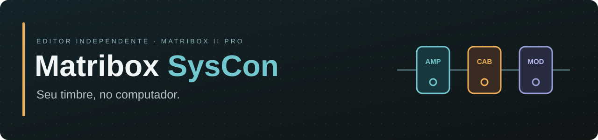
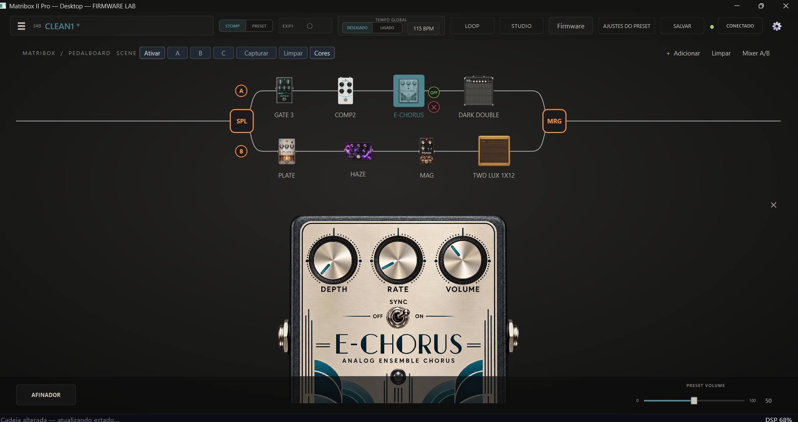

**Controle e edite sua SONICAKE Matribox II Pro pelo computador.**

Presets, pedais e controles em uma interface visual feita para explorar seus timbres.

**[Baixar para Windows](https://github.com/hurricaneabel/matribox-syscon/releases/tag/v1.0-beta)** · **[Primeiros passos](#comece-a-tocar)** · **[Relatar um problema](https://github.com/hurricaneabel/matribox-syscon/issues)**

> **Download disponível: v1.0-beta · Windows x64 · Pré-release.** O apoio ao projeto é voluntário e não libera recursos exclusivos.

---

## Seus pedais, em uma tela maior

Veja a cadeia de efeitos, encontre seus presets e ajuste os controles sem perder a visão do conjunto. Escolha a interface **Essencial** ou **Pedaleira**, conforme sua maneira de trabalhar.

*Imagem de desenvolvimento no perfil Lab. Recursos e aparência podem variar conforme a versão do app e o firmware instalado; consulte as notas do download.*

## O que você pode fazer

| Recurso | No SysCon |
|---|---|
| **Monte seus timbres** | Edite parâmetros e organize a cadeia de efeitos pela interface visual. |
| **Organize seus presets** | Leia, edite e gerencie seus sons, com importação e exportação nos formatos compatíveis. |
| **Traga seus modelos** | Importe NAM e IR e identifique seus slots pela biblioteca. |
| **Escolha sua interface** | Alterne entre os modos Essencial e Pedaleira. |
| **Explore o perfil Lab** | Acesse cenas e controles adicionais quando suportados pelo firmware e pela versão do app. |

## Comece a tocar

1. Abra a página de **[releases](https://github.com/hurricaneabel/matribox-syscon/releases)** e baixe o ZIP da versão desejada.
2. Extraia **a pasta inteira** para um local em que você possa salvar arquivos.
3. Execute `SysCon.exe`, mantendo a pasta `_internal` junto do programa. Não é necessário instalar Python.
4. Feche outros editores que estejam usando a porta MIDI, conecte a Matribox e escolha o perfil correspondente em **Configurações**.

O perfil inicial é **Oficial**. O aplicativo não instala firmware automaticamente. Preferências e registros são criados na pasta `userdata` do aplicativo. Leia as instruções específicas da release antes de substituir uma instalação anterior.

## Oficial ou Lab?

| Perfil | Para qual firmware? | O que esperar |
|---|---|---|
| **Oficial** | Firmware padrão da Matribox II Pro | Recursos compatíveis com o firmware original. |
| **Lab** | Firmware modificado compatível | Cenas A/B/C, volume por cena, `.labprst`, controles adicionais e demais integrações disponíveis na combinação instalada. |

**Escolher Lab no aplicativo não adiciona funções ao firmware oficial.** Este repositório distribui o app; firmware é uma atualização separada. No perfil Lab, até 20 posições Clone dependem de firmware compatível.

## Compatibilidade

- **Equipamento:** SONICAKE Matribox II Pro. Não presumir compatibilidade com outros modelos da linha.
- **Download atual:** Windows x64, portátil; confira os requisitos e as limitações na release escolhida.
- **Estado:** pré-release em desenvolvimento. Os testes offline não garantem funcionamento em toda instalação do Windows ou combinação de firmware.
- **Pacote:** as artes dos efeitos representam parte considerável do tamanho do download. O motor de separação de stems por IA não está incluído no pacote descrito nas releases atuais.

## Acompanhe as melhorias

Correções, novidades e limitações de cada versão ficam nas **[notas de release](https://github.com/hurricaneabel/matribox-syscon/releases)**. Consulte-as para confirmar quais recursos estão incluídos no arquivo que você vai baixar.

Na **1.0-beta**, o SysCon acompanha o firmware Lab 10: roteamento A/B sem gastar slots, os efeitos Transposer, Classic e Modern Stereolizer, Arena e Cloud, Preset CTRL 2/3, Scene + Stomp, Bank on Hold, FS Mode, os 3 perfis de Global EQ com vínculo por preset, Drum Sync e Auto Rec do Looper e macros sem MIDI Clock. O download ficou muito menor (cerca de 460 MB). [Veja as notas completas](https://github.com/hurricaneabel/matribox-syscon/releases/tag/v1.0-beta).

Encontrou um problema? **[Abra uma issue](https://github.com/hurricaneabel/matribox-syscon/issues/new)** com:

- versão do Windows, do SysCon e do firmware;
- perfil Oficial/Lab e interface Essencial/Pedaleira;
- passos para reproduzir e, se possível, uma imagem do comportamento;
- quando solicitado, `userdata/logs/syscon.log`, revisando dados pessoais antes de publicar.

## Apoie o desenvolvimento

O SysCon é desenvolvido de forma independente. Se ele faz parte dos seus timbres, você pode apoiar a continuidade do projeto pela plataforma de sua preferência:

- **[APOIA.se — apoio no Brasil](https://apoia.se/matriboxsyscon)**
- **[Buy Me a Coffee — apoio internacional](https://buymeacoffee.com/matribox.syscon)**

**O apoio é totalmente voluntário.** Usar o aplicativo não exige contribuição. Quem apoia recebe os mesmos recursos e atualizações que todos os outros usuários: não há funções exclusivas, versões antecipadas nem prioridade de suporte em troca de doações.

## Licença e créditos

O SysCon é gratuito, mas **não é software livre**. O uso segue o `LICENSE.txt` incluído no download, com as condições de uso pessoal e restrições de redistribuição, modificação e engenharia reversa. Os componentes de terceiros seguem suas próprias licenças, descritas em `THIRD_PARTY_NOTICES.txt` e na pasta `licenses` do pacote.

Este repositório reúne downloads, notas de versão e relatos de problemas. Projeto independente, sem vínculo oficial com a SONICAKE. Marcas e nomes de produtos pertencem aos respectivos titulares.
